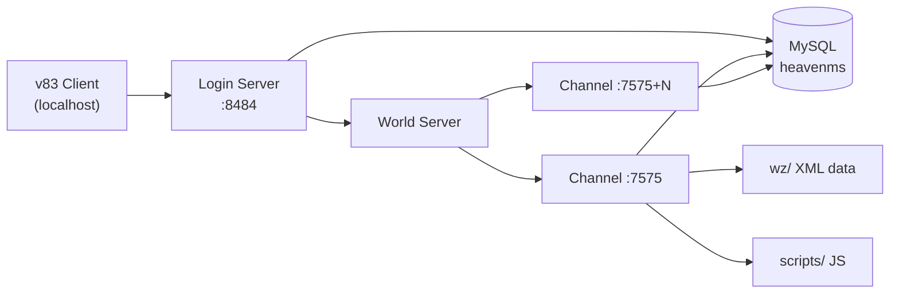

<p align="center">
  
</p>

<h1 align="center">HeavenMS</h1>

<p align="center">
  Open-source MapleStory v83 private server emulator with extensive gameplay fixes, scripting, and configuration options.
</p>

<p align="center">
  <strong>Head developer:</strong> Ronan C. P. Lana
</p>

---

## Table of Contents

- [Overview](#overview)
- [Features](#features)
- [Requirements](#requirements)
- [Quick Start](#quick-start)
- [Database Setup](#database-setup)
- [Configuration](#configuration)
- [Building the Server](#building-the-server)
- [Running the Server](#running-the-server)
- [Client Setup](#client-setup)
- [Project Structure](#project-structure)
- [Scripting](#scripting)
- [Development Tools](#development-tools)
- [Networking and Ports](#networking-and-ports)
- [Administration](#administration)
- [WZ Data and Synchronization](#wz-data-and-synchronization)
- [Known Issues](#known-issues)
- [HeavenClient](#heavenclient)
- [Contributing and Support](#contributing-and-support)
- [License and Disclaimer](#license-and-disclaimer)

---

## Overview

HeavenMS is a Java-based MapleStory **v83** server emulator derived from the OdinMS / MapleSolaxia lineage. It aims to recreate the pre-Big Bang MapleStory experience while fixing many gameplay issues found in both the original WZ data and server source.

This is **not** a drop-in replacement for stock v83 WZ files. HeavenMS includes server-side fixes, edited WZ/XML data, and custom behaviors. For the best experience, use the **provided WZ set** from the official HeavenMS resources rather than mixing clean Nexon files with partial custom data.

### Credits

| Role | Contributors |
|------|--------------|
| Head developer | Ronan C. P. Lana |
| Freelance developer | Vcoc |
| Contributors | Thora, GabrielSin, Masterrulax, MedicOP |
| Additional patches | shavit, kolakcc (Familiar), Dragohe4rt, Jayd, Ubaware, and many others |

MapleStory and all related IP are owned by **Wizet / Nexon**. This project is a community emulator and is not affiliated with Nexon.

---

## Features

HeavenMS ships with a large set of gameplay systems and fixes. Highlights include:

### Gameplay Systems

- Multi-world and multi-channel architecture with per-world rates
- Party Quests, expeditions, Monster Carnival, Guild PQ, Dojo, and custom PQs (BossRush, CafePQ)
- Guild, alliance, marriage, family, and wedding systems
- Cash shop, coupons, Duey, Fredrick storage, and player shops / hired merchants
- Equipment leveling, Maker skill, pet autopot, inventory sort/merge, and storage arrange
- Player NPCs, Hall of Fame, rankings, and party search
- Bcrypt password hashing, auto-registration, PIN/PIC bypass, and login anti-abuse coordination

### Server Engineering

- YAML-based configuration (`config.yaml`) with hundreds of toggles
- HikariCP connection pooling and Java thread pool task management
- Rhino/JavaScript scripting for NPCs, quests, portals, reactors, events, and items
- Server-side WZ/XML data under `wz/` for maps, mobs, items, skills, and more
- 30+ maintenance and content tools under `tools/`

For a detailed feature breakdown, see [`docs/feature_list.md`](docs/feature_list.md).

---

## Requirements

| Component | Version / Notes |
|-----------|-----------------|
| **Java** | **JDK 8** (Java 7 is no longer supported) |
| **MySQL / MariaDB** | 5.x or compatible (tested with local MySQL) |
| **RAM** | 2 GB minimum for the JVM (`-Xmx2048m` in launch scripts) |
| **IDE** (recommended) | NetBeans, IntelliJ IDEA, or Eclipse |
| **Client** | MapleStory v83 client + modified localhost (see [Client Setup](#client-setup)) |
| **WZ files** | Server `wz/` XML set + matching client WZ recommended |

### Dependencies

Runtime JARs live in the `cores/` directory and are loaded at startup:

```
cores/
  mina-core-*.jar
  slf4j-api-*.jar
  slf4j-jdk14-*.jar
  yamlbeans-*.jar
  mysql-connector-*.jar
  hikaricp-*.jar
  ... (and other bundled libraries)
```

Compiled server classes are expected in `dist/`.

---

## Quick Start

1. **Clone** this repository.
2. **Install** MySQL and create the `heavenms` database (see [Database Setup](#database-setup)).
3. **Edit** `config.yaml` with your database credentials and server IP.
4. **Build** the project (see [Building the Server](#building-the-server)).
5. **Run** `launch.bat` (Windows) or `linux-launch.sh` (Linux).
6. **Connect** with a v83 localhost client pointed at your server IP.

---

## Database Setup

Execute the SQL scripts **in order** from the `sql/` directory:

| Order | File | Required | Description |
|-------|------|----------|-------------|
| 1 | `db_database.sql` | Yes | Creates the `heavenms` schema, tables, and base data |
| 2 | `db_drops.sql` | Yes | Populates drop tables |
| 3 | `db_shopupdate.sql` | Optional | Updates NPC shops with custom goods (requires provided WZs) |

### Example (MySQL CLI)

```sql
SOURCE /path/to/HeavenMS/sql/db_database.sql;
SOURCE /path/to/HeavenMS/sql/db_drops.sql;
-- Optional:
SOURCE /path/to/HeavenMS/sql/db_shopupdate.sql;
```

### Database user

Create a MySQL user with access to the `heavenms` database and set matching credentials in `config.yaml`:

```yaml
server:
  DB_URL: "jdbc:mysql://localhost:3306/heavenms?characterEncoding=UTF-8&useSSL=false"
  DB_USER: "your_user"
  DB_PASS: "your_password"
```

### First account

By default, `AUTOMATIC_REGISTER: true` lets players create accounts on first login. Alternatively, insert a row manually into the `accounts` table.

---

## Configuration

All server settings are loaded from **`config.yaml`** at startup via `config.YamlConfig`.

### World settings

Each world entry controls name, channel count, and rates:

```yaml
worlds:
  - flag: 0
    server_message: Welcome to Scania!
    event_message: Scania!
    why_am_i_recommended: Welcome to Scania!
    channels: 3
    exp_rate: 10
    meso_rate: 10
    drop_rate: 10
    boss_drop_rate: 10
    quest_rate: 5
    fishing_rate: 10
    travel_rate: 10
```

Up to 21 worlds can be defined. Only the first `server.WORLDS` entries are loaded at boot.

### Common server settings

| Setting | Default | Description |
|---------|---------|-------------|
| `HOST` | `127.0.0.1` | IP sent to the client during login |
| `LOCALSERVER` | `true` | Local development mode |
| `WORLDS` | `1` | Number of worlds to start |
| `CHANNEL_LOAD` | `100` | Max players per channel |
| `AUTOMATIC_REGISTER` | `true` | Auto-create accounts on login |
| `ENABLE_PIC` / `ENABLE_PIN` | `true` | Character delete / security features |
| `USE_AUTOSAVE` | `true` | Periodic character saves |
| `TIMEZONE` | `GMT-3` | Server timezone |

The full list of flags (scroll behavior, buff rules, PQ options, wedding settings, etc.) is documented inline in `config.yaml`. Type definitions live in `src/config/ServerConfig.java` and `src/config/WorldConfig.java`.

> **Note:** Older guides refer to `configuration.ini`. This repository uses **`config.yaml`** instead.

---

## Building the Server

### Option A: NetBeans (recommended in original docs)

1. Create a new project **from existing sources**.
2. Set the source folder to `src/`.
3. Add all JARs from `cores/` to the project classpath.
4. Set the main class to `net.server.Server`.
5. Run **Clean and Build** — output goes to `dist/`.

### Option B: Command line (manual compile)

From the repository root, with JDK 8 on your PATH:

```bat
mkdir dist 2>nul
dir /s /B src\*.java > sources.txt
javac -encoding UTF-8 -d dist -cp "cores/*" @sources.txt
```

On Linux/macOS:

```bash
mkdir -p dist
find src -name "*.java" > sources.txt
javac -encoding UTF-8 -d dist -cp "cores/*" @sources.txt
```

Ensure `dist/` contains the compiled classes before launching.

---

## Running the Server

Run from the **repository root** so relative paths resolve correctly.

### Windows

```bat
launch.bat
```

### Linux

```bash
chmod +x linux-launch.sh
./linux-launch.sh
```

Both scripts start the server with:

```
java -Xmx2048m -Dwzpath=wz\ net.server.Server
```

On Linux, `linux-launch.sh` uses `wz/` as the WZ path separator.

### Successful startup

You should see output similar to:

```
HeavenMS v83 starting up.
Listening on port 8484
```

Channel servers bind starting at port **7575**.

---

## Client Setup

HeavenMS requires a **v83 MapleStory client** and a **modified localhost executable**. Official client assets and tools are distributed separately:

- **Server source:** https://github.com/ronancpl/HeavenMS
- **Client files & tools:** https://drive.google.com/drive/folders/0BzDsHSr-0V4MYVJ0TWIxd05hYUk

### Basic client installation

1. Install MapleStory v83 using `ManagerMsv83.exe`.
2. Remove: `HShield/` folder, `ASPLnchr.exe`, `MapleStory.exe`, and `Patcher.exe`.
3. Place the modified `localhost.exe` in the client folder.
4. Overwrite client WZ files with the provided set (`commit397_wz` for stable release, or `current_wz` for latest).

### Pointing the client at your server

- If `HOST` in `config.yaml` is `127.0.0.1`, the default localhost usually works for local play.
- For a remote IP, hex-edit `localhost.exe` and replace all `127.0.0.1` string occurrences with your server address.

### Antivirus warning

Modified localhost executables are often flagged by antivirus software because of reverse-engineering patches. The community builds linked above have been widely used; scan at your own discretion.

### Windows 8/10 compatibility

If the client fails to open despite the server seeing a connection attempt, try:

- Compatibility mode: Windows 7
- Run as administrator
- Use the `lolwut.exe` helper (see Google Drive tools)

Allow Java and the client through Windows Firewall for ports **8484** and **7575–7575+N** (N = number of channels).

---

## Project Structure

```
HeavenMS/
├── config.yaml          # Main server configuration (YAML)
├── launch.bat           # Windows startup script
├── linux-launch.sh      # Linux startup script
├── LICENSE              # GNU AGPL v3
├── cores/               # Runtime dependency JARs
├── dist/                # Compiled server classes (build output)
├── docs/                # Feature list, known issues
├── handbook/            # Item/NPC/mob ID reference text files
├── logs/                # Runtime logs (gitignored)
├── scripts/             # JavaScript game scripts
│   ├── npc/             # NPC dialog and shop scripts
│   ├── quest/           # Quest scripts
│   ├── portal/          # Map portal scripts
│   ├── reactor/         # Reactor interaction scripts
│   ├── event/           # Event / PQ / expedition scripts
│   ├── item/            # Usable item scripts
│   └── map/             # Map entry scripts (onUserEnter, etc.)
├── sql/                 # Database schema and data
├── src/                 # Java server source code
│   ├── client/          # Player, inventory, commands, skills
│   ├── config/          # YAML config loaders
│   ├── constants/       # Game and network constants
│   ├── net/             # Networking, handlers, channels, worlds
│   ├── provider/        # WZ/XML data providers
│   ├── scripting/       # Script engine managers
│   ├── server/          # Maps, life, quests, shops, events
│   └── tools/           # Packets, crypto, DB, utilities
├── tools/               # Standalone maintenance utilities (Ant/NetBeans)
└── wz/                  # Server-side WZ data as XML
    ├── Base.wz/
    ├── Character.wz/
    ├── Effect.wz/
    ├── Etc.wz/
    ├── Item.wz/
    ├── Map.wz/
    ├── Mob.wz/
    ├── Morph.wz/
    ├── Npc.wz/
    ├── Quest.wz/
    ├── Reactor.wz/
    ├── Skill.wz/
    ├── Sound.wz/
    └── String.wz/
```

### Architecture overview



---

## Scripting

Game content is extended through **Rhino JavaScript** files under `scripts/`.

| Directory | Purpose | Example |
|-----------|---------|---------|
| `scripts/npc/` | NPC conversations, shops, custom NPCs | `scripts/npc/9000000.js` |
| `scripts/quest/` | Quest start/progress/complete logic | `scripts/quest/22000.js` |
| `scripts/portal/` | Map transitions and portals | `scripts/portal/guildwaitingenter.js` |
| `scripts/reactor/` | Reactor hit actions | `scripts/reactor/1021000.js` |
| `scripts/event/` | PQ, expedition, and event instances | `scripts/event/HenesysPQ.js` |
| `scripts/item/` | Custom usable item behavior | `scripts/item/removethorns.js` |
| `scripts/map/` | Map entry hooks | `scripts/map/onUserEnter/startEreb.js` |

Reload scripts in-game without restart using GM commands such as `!reloadevents`, `!reloadportals`, and `!reloadmap`.

---

## Development Tools

The `tools/` directory contains standalone Java utilities for WZ validation, drop data generation, quest auditing, and more. Each tool is a small NetBeans/Ant project with its own `build.xml`.

| Tool | Purpose |
|------|---------|
| `MapleMobBookUpdate` | Sync Monster Book drops from DB to WZ XML |
| `MapleMesoFetcher` | Generate meso drop data for overworld mobs |
| `MapleArrowFetcher` | Update arrow drop quantities |
| `MapleBossHpBarFetcher` | Find mobs missing boss HP bar metadata |
| `MapleDojoUpdater` | Patch dojo map script references |
| `MapleEquipmentOmnileveler` | Add equipment level data to WZ |
| `MapleCodeCouponGenerator` | Generate coupon codes in DB |
| `MapleQuestlineFetcher` | Find quests missing script files |
| `MapleInvalidItemIdFetcher` | Detect invalid item IDs in DB |
| `MapleWorldmapChecker` | Validate world map tooltips |

Build a tool by opening its folder in NetBeans or running Ant from that directory. See [`docs/feature_list.md`](docs/feature_list.md) for the complete tool list.

---

## Networking and Ports

| Service | Port | Protocol |
|---------|------|----------|
| Login server | **8484** | TCP |
| Channel 1 | **7575** | TCP |
| Channel 2 | **7576** | TCP |
| Channel N | **7575 + (N − 1)** | TCP |

### Local play

Set `HOST: 127.0.0.1` in `config.yaml`. No port forwarding required.

### LAN / Internet play

1. Set `HOST` to your machine's LAN or public IP.
2. Forward ports **8484** and **7575 through 7575 + (channels − 1)** on your router.
3. Hex-edit the client localhost if not connecting locally.
4. Add firewall rules for the client and Java.

Hamachi or other VPN tunneling works as an alternative to port forwarding.

---

## Administration

### GM commands

Type `@commands` in all-chat to list commands available for your character's GM level. GM levels range from 0 (player-accessible) through 6 (full server admin).

To promote a character, set the `gm` column in the `characters` table while the character is offline:

```sql
UPDATE characters SET gm = 6 WHERE name = 'YourCharacterName';
```

### Useful GM commands

| Command | Level | Description |
|---------|-------|-------------|
| `@help` | 0+ | Command help |
| `@rates` | 0+ | Show current rates |
| `@ranks` | 0+ | Server rankings |
| `@warp` | 2+ | Warp to map or player |
| `@item` | 2+ | Spawn items |
| `@spawn` | 3+ | Spawn mobs |
| `@notice` | 3+ | Server notice |
| `@exprate` | 4+ | Change EXP rate |
| `@shutdown` | 6 | Shut down server |

### Logs

Runtime logs are written under `logs/` (excluded from git). Check here when debugging crashes, script errors, or packet issues.

---

## WZ Data and Synchronization

The server reads WZ content from **`wz/`** as exported XML (set via `-Dwzpath=wz`).

### Editing workflow

1. Edit client WZ files with **HaRepacker 4.2.4** using encryption **GMS (old)**.
2. Save changes to the client WZ folder.
3. Re-export changed nodes to the server's `wz/` XML using HaRepacker's **Private Server** export option.

**Important:** Keep client WZ and server XML in sync. Mixing stock v83 files with partial HeavenMS edits often causes subtle bugs.

### Client → server vs server → client

- **Client → server** reimport is generally safe.
- **Server → client** reimport can cause client-side issues if done carelessly. Only reimport nodes you understand.

### Monster Book example

See the original HeavenMS docs and `tools/MapleMobBookUpdate` for updating Monster Book drop data from the database into both server XML and client WZ.

---

## Known Issues

HeavenMS is a community emulator and is **not production-stable out of the box**. Notable issues include:

- Deadlocks may appear after long uptime with many players online
- Some skills display incorrectly to third parties (crits, stuns, close-range magic)
- Boss HP bar flickering when multiple bosses are present
- Cygnus Wind Archer Final Attack not functional
- Steal skill does not remove loot from the mob drop pool
- MTS is not fully implemented (`USE_MTS: false` by default)

See [`docs/issues.txt`](docs/issues.txt) for the full list.

---

## HeavenClient

An open-source v83 client continuation is maintained separately:

- **HeavenClient:** https://github.com/ryantpayton/HeavenClient

HeavenClient builds on SYJourney's JourneyClient and adds higher resolution support, UI improvements, and ongoing client-side fixes.

---

## Contributing and Support

### Community

- **Discord:** https://discord.gg/Q7wKxHX
- **Project survey / visualizations:** https://heavenms-survey.home.blog/2019/12/24/project-visualizations/

### Contributing

1. Fork the repository.
2. Create a focused branch for your change.
3. Match existing code style and conventions.
4. Test locally against the provided WZ set.
5. Open a pull request with a clear description.

Bug reports, code patches, and documentation improvements are welcome.

---

## License and Disclaimer

### License

This project is licensed under the **GNU Affero General Public License v3.0 (AGPL-3.0)**. See [`LICENSE`](LICENSE) for the full text.

You may install, use, modify, and redistribute this software **provided that**:

- It is **not sold or commercially traded**
- **Credit to original authors is preserved**
- Derivative works comply with AGPL terms

### Usage terms

- HeavenMS is **open-source** and intended for **non-commercial**, nostalgic, local entertainment.
- **MapleStory** is the property of Wizet/Nexon. Support the official game.
- HeavenMS staff has **no intention** to operate a public official server with this source. **Do not fall for scams** claiming to be an official HeavenMS service.

### Stability notice

This source is **not guaranteed stable** for long-running public servers without additional deadlock review, monitoring, and maintenance. Use at your own risk.

---

<p align="center">
  If this project helped you, consider starring the repository.
</p>
