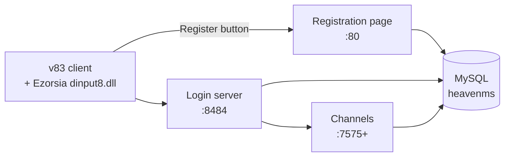

<h1 align="center">RafaelMS</h1>

<p align="center">
  A MapleStory v83 private server based on <a href="https://github.com/ronancpl/HeavenMS">HeavenMS</a>, with web account registration, a one-click server setup wizard and a Windows client installer.
</p>

---

## Table of Contents

- [What RafaelMS adds](#what-rafaelms-adds)
- [Requirements](#requirements)
- [Quick Start (Windows)](#quick-start-windows)
- [Server Setup Wizard](#server-setup-wizard)
- [Account Registration](#account-registration)
- [Client and Installer](#client-and-installer)
- [Configuration](#configuration)
- [Manual Setup](#manual-setup)
- [Networking and Ports](#networking-and-ports)
- [Administration](#administration)
- [Project Structure](#project-structure)
- [Scripting and WZ Data](#scripting-and-wz-data)
- [Known Issues](#known-issues)
- [Credits and License](#credits-and-license)

---

## What RafaelMS adds

RafaelMS is HeavenMS plus the following changes. Everything else (gameplay systems, scripts, WZ data, tools) is upstream HeavenMS. For the full upstream feature list, see [`docs/feature_list.md`](docs/feature_list.md).

| Area | Change | Files |
|------|--------|-------|
| **Account registration** | Built-in web server hosts a sign-up page. The client's **Register** button opens it. | `src/net/server/web/RegisterWebServer.java`, `web/` |
| **Login** | `WEB_REGISTER_REQUIRED` allows only accounts created on the website to log in. `AUTOMATIC_REGISTER` is off. | `LoginPasswordHandler.java`, `AcceptToSHandler.java` |
| **Database** | New `accounts.webregistered` column | `sql/db_database.sql` |
| **Character creation** | Explorers only. Cygnus and Aran are hidden in the client, and any job request creates an Explorer, so the client no longer gets stuck on the race screen. | `CreateCharHandler.java` |
| **Server setup** | GUI/silent wizard that installs Java and MySQL, imports the database, writes `config.yaml`, compiles the server and opens the firewall | `setup-server.bat`, `setup/ServerSetupWizard.ps1` |
| **Client** | Inno Setup installer for the unmodified Nexon v83 client + MapleEzorsia v2 (`dinput8.dll`). No third-party localhost `.exe`. | `installer/RafaelMS-Client.iss` |
| **Config** | New keys `WEB_REGISTER`, `WEB_PORT`, `WEB_REGISTER_REQUIRED` | `config.yaml`, `src/config/ServerConfig.java` |
| **Gameplay fixes** | Steal no longer drops the stolen item again on death. Monster Magnet ignores fixed mobs and bosses (client crash). Snipe's shown damage matches the damage dealt. The boss HP bar no longer flickers when one attack hits several bosses. The 30-day temp-ban check for name change and world transfer works. | `AbstractDealDamageHandler.java`, `SpecialMoveHandler.java`, `MapleMap.java`, `MapleMonster.java`, `MapleCharacter.java`, `TransferNameHandler.java` |

---

## Requirements

| Component | Notes |
|-----------|-------|
| **OS** | Windows 10/11 for the setup wizard and installer. The server itself also runs on Linux. |
| **Java** | JDK 8 (the wizard installs it if it's missing) |
| **MySQL** | 5.x or 8.x (the wizard installs it if it's missing) |
| **RAM** | About 2 GB for the JVM (`-Xmx2048m`, configurable in the wizard) |
| **Client** | Built by the installer in [`installer/`](installer/). See [Client and Installer](#client-and-installer). |

---

## Quick Start (Windows)

1. **Clone** the repo:
   ```bat
   git clone https://github.com/coka13/RafaelMS.git
   ```
2. **Run** `setup-server.bat` and follow the wizard (see [Server Setup Wizard](#server-setup-wizard)). It asks for administrator rights.
3. **Start** the server with `launch.bat`. You should see:
   ```
   Listening on port 8484
   Registration page on http://<HOST>/register.html
   HeavenMS is now online.
   ```
4. **Create an account** at `http://<HOST>/register.html`, or click **Register** on the client's login screen.
5. **Install the client** with `RafaelMS-Client-Setup.exe`, enter the server IP and log in.

---

## Server Setup Wizard

`setup-server.bat` runs [`setup/ServerSetupWizard.ps1`](setup/ServerSetupWizard.ps1). It does the following:

1. Checks for the Java 8 JDK and MySQL, and installs missing ones with `winget`
2. Starts the MySQL service if it's stopped
3. Imports `sql/db_database.sql`, `db_drops.sql` and `db_shopupdate.sql` in order. If a `heavenms` database already exists, it's backed up with `mysqldump` before being replaced.
4. Relaxes MySQL `sql_mode` (HeavenMS relies on zero dates and non-strict inserts)
5. Creates a dedicated DB user with `mysql_native_password`, which the bundled Connector/J 5.1 driver needs on MySQL 8
6. Writes `DB_URL`, `DB_USER`, `DB_PASS`, `HOST` and `LOCALSERVER` into `config.yaml`
7. Compiles `src/` into `dist/` when needed
8. Points `launch.bat` at the detected JDK and sets the JVM heap
9. Opens Windows Firewall for the registration page (80), the login port (8484) and every channel port
10. Tests the database login with the server's own JDBC driver

Logs go to `setup/logs/` and database backups to `setup/backups/` (both are gitignored).

### Unattended run

```bat
setup-server.bat -Silent -AdminPassword "rootpw" -ServerIp 203.0.113.10
```

Useful switches: `-ExistingDatabase Keep|Recreate`, `-DbUser`, `-DbPassword` (random if empty), `-UseAdminForServer`, `-Build Auto|Always|Never`, `-HeapMB 2048`, `-SkipFirewall`, `-SkipShopUpdate`, `-SkipSqlMode`, `-SkipLaunchScript`, `-SkipDriverTest`.

---

## Account Registration

The server runs a small HTTP server (`RegisterWebServer`) next to the game server. It serves the files in `web/` and handles `POST /register`.

- **Page:** `http://<HOST>/register.html` (`web/register.html` and `web/bg.jpg`)
- **Username:** 4–12 letters or digits
- **Password:** 6–12 printable characters, no spaces. Stored with bcrypt (cost 12).
- **Email:** optional
- **Rate limits per IP:** 3 accounts and 30 attempts per hour

Accounts created on the page get `webregistered = 1`. With `WEB_REGISTER_REQUIRED: true`, any other account gets "not a registered ID" at login.

### Upgrading an existing database

If your `heavenms` database is older than this change, add the column and mark the accounts you want to keep, such as your GM account:

```sql
ALTER TABLE accounts ADD COLUMN webregistered TINYINT(1) NOT NULL DEFAULT 0 AFTER email;
UPDATE accounts SET webregistered = 1 WHERE name = 'YourAdminAccount';
```

### Port 80 in use?

If the console prints `Could not start the registration web server on port 80`, another program (IIS, Skype or another web server) is using the port. Change `WEB_PORT` in `config.yaml`, and set `RegisterURL` in the client's `config.ini` to match.

---

## Client and Installer

The client is the **unmodified, Nexon-signed v83 `MapleStory.exe`** plus **MapleEzorsia v2** loaded as `dinput8.dll`. Ezorsia patches the client in memory and connects to `ServerIP_Address` from `config.ini`, so no hex-edited localhost is needed, which avoids antivirus false positives.

### For players

1. Run `RafaelMS-Client-Setup.exe`. It installs per user with no admin prompt, unless the VC++ runtime has to be installed.
2. Enter the server IPv4 address on the **Server address** page (pre-filled with the default).
3. Start RafaelMS from the Start menu or desktop. `MapleStory.exe` asks for administrator rights (UAC).

To change the server later, edit `ServerIP_Address` in `config.ini`. The Start menu has a **Client settings (config.ini)** shortcut.

Silent install with a preset server:

```bat
RafaelMS-Client-Setup.exe /SILENT /SERVER=203.0.113.10
```

### Building the installer

The script is [`installer/RafaelMS-Client.iss`](installer/RafaelMS-Client.iss) (Inno Setup 6). It expects:

| Input | Location |
|-------|----------|
| Client files (`MapleStory.exe`, `dinput8.dll`, `config.ini`, `*.wz`, DLLs, `Icon.ico`) | `ClientSrc`, default `C:\Nexon\RafaelMS-Client` |
| VC++ 2015–2022 x86 runtime | `installer/redist/vc_redist.x86.exe` (not in git) |

```bat
cd installer
"%LOCALAPPDATA%\Programs\Inno Setup 6\ISCC.exe" /DDefaultServer="203.0.113.10" RafaelMS-Client.iss
```

The output is `installer/Output/RafaelMS-Client-Setup.exe` (gitignored, about 1.5 GB). Set `DefaultServer` to your public IP for releases, so players can just click Next.

### Client notes

- **Windowed only.** v83 full screen fails on some PCs with `error code -2147467259 (Unspecified error)`, so the installer keeps the default Ezorsia 1280×720 window.
- **Explorers only.** The client's `UI.wz` hides the Cygnus and Aran buttons, and the server creates an Explorer for any job.

---

## Configuration

All settings live in **`config.yaml`** (types in `src/config/ServerConfig.java` and `WorldConfig.java`). Each option is commented inline.

### RafaelMS settings

| Setting | Value | Description |
|---------|-------|-------------|
| `WEB_REGISTER` | `true` | Serve the registration page |
| `WEB_PORT` | `80` | Port of the registration page (the client opens port 80 by default) |
| `WEB_REGISTER_REQUIRED` | `true` | Only accounts created on the page can log in |
| `AUTOMATIC_REGISTER` | `false` | Upstream auto-register on first login (off, because the website handles sign-ups) |

### Common settings

| Setting | Description |
|---------|-------------|
| `DB_URL` / `DB_USER` / `DB_PASS` | Database connection (written by the wizard). The committed file has an empty `DB_PASS`. |
| `HOST` | IP sent to clients. Use your LAN or public IP for remote players. |
| `LOCALSERVER` | `true` for local play |
| `WORLDS` | Number of worlds to start |
| `CHANNEL_LOAD` | Max players per channel |
| `ENABLE_PIC` / `ENABLE_PIN` | Character security features |

World name, channel count and rates are set per world under `worlds:`.

> **Don't commit your real database password.** Your local `config.yaml` will show as modified, so leave it out of commits, or commit it with `DB_PASS: ""`.

---

## Manual Setup

Without the wizard, or on Linux:

1. **Database.** Run these in order: `sql/db_database.sql`, `sql/db_drops.sql`, and optionally `sql/db_shopupdate.sql`. On MySQL 8, create the server's user with `mysql_native_password`, and relax `sql_mode` (remove `STRICT_TRANS_TABLES`, `NO_ZERO_DATE` and `NO_ZERO_IN_DATE`).
2. **Config.** Set the database credentials and `HOST` in `config.yaml`.
3. **Compile** (JDK 8):
   ```bat
   mkdir dist 2>nul
   dir /s /B src\*.java > sources.txt
   javac -encoding UTF-8 -d dist -cp "cores/*" @sources.txt
   ```
   ```bash
   mkdir -p dist && find src -name "*.java" > sources.txt
   javac -encoding UTF-8 -d dist -cp "cores/*" @sources.txt
   ```
4. **Run** from the repo root with `launch.bat` or `./linux-launch.sh`:
   ```
   java -Xmx2048m -Dwzpath=wz\ net.server.Server
   ```
   `-Dwebpath=<dir>` overrides the folder the registration page is served from (default `web`).

---

## Networking and Ports

| Service | Port |
|---------|------|
| Registration page (HTTP) | **80** (`WEB_PORT`) |
| Login server | **8484** |
| Channels | **7575** through **7575 + channels − 1** |

For players outside your network:

1. Set `HOST` in `config.yaml` to your public IP.
2. Forward TCP 80, 8484 and the channel ports on your router.
3. Build the client installer with `/DDefaultServer="<public IP>"`.

The wizard adds the Windows Firewall rules (group **RafaelMS Server**) for ports 80, 8484 and the channel ports. If you change `WEB_PORT`, open the new port yourself.

---

## Administration

Promote a character while it's offline:

```sql
UPDATE characters SET gm = 6 WHERE name = 'YourCharacterName';
```

Type `@commands` in game to list the commands for your GM level (0 = player, 6 = admin). Useful ones: `@rates`, `@warp`, `@item`, `@spawn`, `@notice`, `@exprate`, `@shutdown`. Reload scripts without restarting using `!reloadevents`, `!reloadportals` and `!reloadmap`.

Runtime logs are in `logs/` (gitignored).

---

## Project Structure

```
HeavenMS/
├── config.yaml              # Server configuration
├── launch.bat               # Windows start script (JDK path set by the wizard)
├── setup-server.bat         # RafaelMS: server setup wizard launcher
├── setup/                   # RafaelMS: ServerSetupWizard.ps1 (+ logs/, backups/, gitignored)
├── web/                     # RafaelMS: registration page (register.html, bg.jpg)
├── installer/               # RafaelMS: Inno Setup client installer script
├── cores/                   # Runtime dependency JARs
├── dist/                    # Compiled classes (build output)
├── docs/                    # Upstream feature list and known issues
├── handbook/                # Item/NPC/mob ID references
├── scripts/                 # JavaScript game scripts (npc, quest, portal, reactor, event, item, map)
├── sql/                     # Database schema and data
├── src/                     # Java source
│   ├── net/server/web/      # RafaelMS: RegisterWebServer
│   └── ...                  # client, config, constants, net, provider, scripting, server, tools
├── tools/                   # Upstream maintenance utilities
└── wz/                      # Server-side WZ data as XML
```



---

## Scripting and WZ Data

These work the same as in upstream HeavenMS:

- **Scripts.** Rhino JavaScript under `scripts/` (npc, quest, portal, reactor, event, item, map).
- **WZ data.** The server reads XML from `wz/`. Edit client WZ files with HaRepacker 4.2.4 (encryption **GMS (old)**), then re-export the changed nodes to `wz/` with the **Private Server** export, so client and server stay in sync.
- **Tools.** Standalone Java utilities in `tools/`, each with its own `build.xml`.

---

## Known Issues

- **Upstream issues.** Possible deadlocks after long uptime, and some skills (Dragon Roar stun, pet commands, some magic attacks) shown wrong to other players. Medal quests, Mystic Door placement and an autoban review are still open. Full list: [`docs/issues.txt`](docs/issues.txt).
- **Client.** Full screen isn't supported (see [Client notes](#client-notes)).
- **Registration.** The page uses plain HTTP, so passwords cross the network unencrypted. Put a TLS reverse proxy in front for public servers.

---

## Credits and License

**HeavenMS** by Ronan C. P. Lana (head developer), Vcoc, Thora, GabrielSin, Masterrulax, MedicOP, and patches from shavit, kolakcc, Dragohe4rt, Jayd, Ubaware and many others. It is derived from the OdinMS / MapleSolaxia lineage. Upstream: https://github.com/ronancpl/HeavenMS

**MapleEzorsia v2** provides the client-side `dinput8.dll`.

RafaelMS is licensed under the **GNU AGPL v3.0** ([`LICENSE`](LICENSE)), like HeavenMS. It must not be sold, and the original authors' credit must be kept. The RafaelMS changes are listed in [What RafaelMS adds](#what-rafaelms-adds).

MapleStory and all related IP belong to **Wizet / Nexon**. This is a non-commercial community project and is not affiliated with Nexon.
